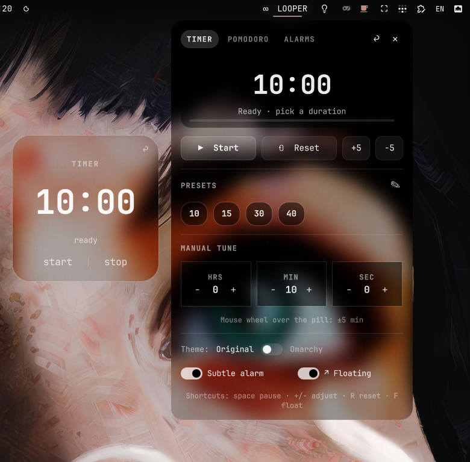
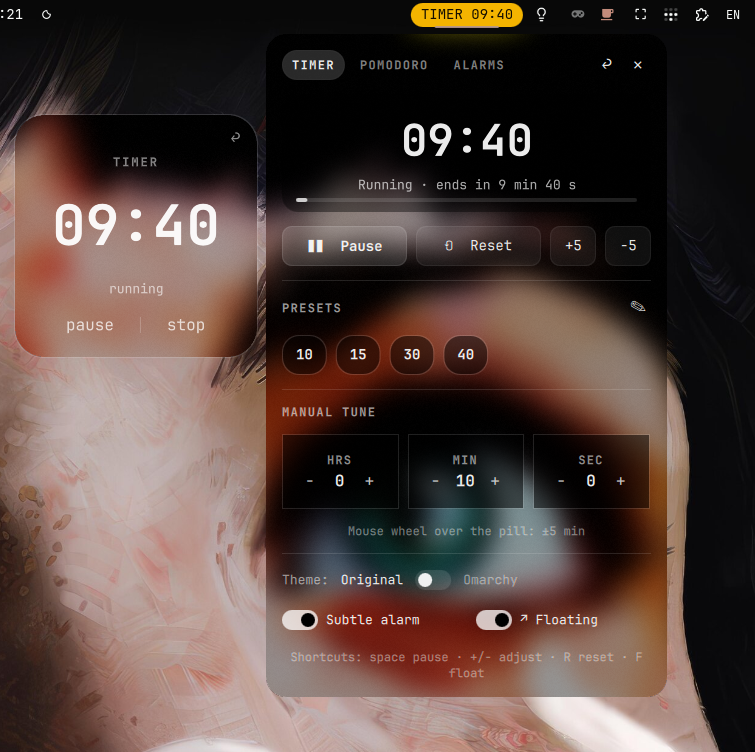
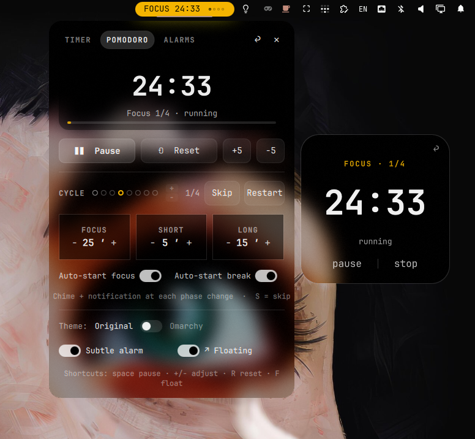
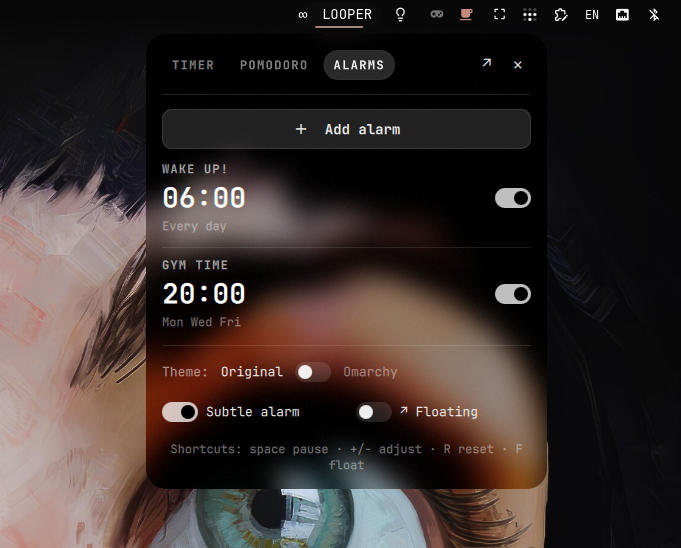
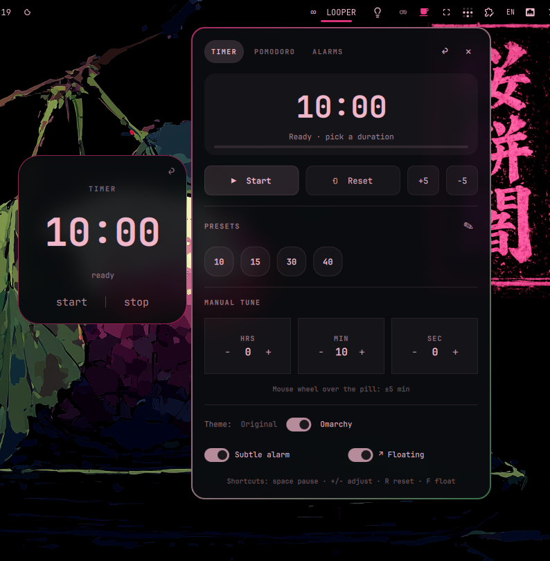

# Looper — timer, pomodoro & alarms for Omarchy

<p align="center">
  <a href="https://plugins.omarchy.org/plugin.html?id=nickmdrummer.timer">
    
  </a>
</p>

Looper is a small time suite for the top bar: a countdown timer, a Pomodoro
cycle and weekly alarms in one widget, with an always-on-top floating card and
real compositor blur.

Listed on the [Omarchy plugin marketplace](https://plugins.omarchy.org/plugin.html?id=nickmdrummer.timer).

## Timer

<p align="center">
  
</p>

- The pill only lights up while a session runs (`TIMER 09:40`); at rest it shows
  `∞ LOOPER`.
- Presets (10, 15, 30, 40 min by default) plus a manual H/M/S picker, with
  `+5` / `−5` that work live while running.
- Presets can be created, renamed and deleted from the panel (✎).
- Middle click pauses or resumes; the wheel adjusts time.
- **Floating card**: a 244×244 glass window that stays on top. Drag it
  anywhere, pause/stop from the card, or press `↩` to send it back to the bar.
  Push it against a screen edge to peek a live ghost on the neighboring
  monitor and release to hop there.

## Pomodoro

<p align="center">
  
</p>

- Focus, short break and long break, with the classic 25 / 5 / 15 minutes and a
  long break every 4 focus blocks. All durations are editable.
- Focus and break are visually distinct by design: amber and calm blue in
  Original, the theme accent and the same calm blue in Omarchy.
- The cycle dots are both progress and control: click a dot (or use the
  stacked `+` / `−`) to set how many focus blocks precede the long break.
- `Skip` and `Restart` sit next to the cycle; auto-start toggles decide
  whether the next phase begins on its own.
- Finishing the long break ends the set. The pill keeps the completed count
  until you start the next one.

## Alarms

<p align="center">
  
</p>

- `Add alarm` opens a 24-hour picker with day chips or a one-click
  `Every day`, a sound toggle and a short name (up to 20 characters) used in
  the notification.
- Each row shows the time, the repeat pattern (`Every day`, `Mon Wed Fri`) and
  an enable toggle. Click a row to edit or delete it.
- When alarms fire together, the chime plays once and every alarm still gets
  its own notification.
- If the session was suspended and the alarm is more than two minutes late,
  Looper only posts a `Missed …` notification: no chime for something you
  already missed.

## Themes

<p align="center">
  
</p>

`Theme: Original [toggle] Omarchy` in the panel footer:

- **Original** keeps a custom dark glass that is denser on light themes.
- **Omarchy** uses the active theme's popup tokens, so the panel looks native
  and takes the theme's own blur amount.

The alarm and Pomodoro colors are intentionally independent from the theme
accent, so focus and break never collapse into the same hue on blue, cyan or
white themes.

## Install

```bash
omarchy plugin add https://github.com/NickmDrummer/omarchy-timer.git --enable --yes
bash ~/.config/omarchy/plugins/nickmdrummer.timer/setup.sh
```

The script adds one blur hook line to `~/.config/hypr/hyprland.lua`
(with a backup, never duplicated) and reloads Hyprland. No shell restart
needed. Manual alternative: append this line yourself, then `hyprctl reload`:

```lua
dofile(os.getenv("HOME") .. "/.config/omarchy/plugins/nickmdrummer.timer/timer-hypr.lua")
```

## Remove

```bash
bash ~/.config/omarchy/plugins/nickmdrummer.timer/setup.sh --remove
omarchy plugin remove nickmdrummer.timer --yes
```

`--remove` deletes only the marked blur block (with a backup) and reloads
Hyprland, so your config is left clean. Your settings
(`~/.config/nickmdrummer-timer/presets.json`) are kept.

## Usage

| Action | What it does |
|---|---|
| Click the pill | Open the panel |
| Middle click | Pause / resume |
| Wheel over the pill | ±5 min at rest, ±1 min while running |
| Wheel over a stepper | ±1 unit, ±5 with Shift |
| `space` | Pause / resume |
| `+` / `-` | Adjust ±5 min |
| `R` | Reset |
| `F` | Floating card |
| `S` | Skip phase (Pomodoro) |
| `Esc` | Close |

## Settings

Stored in the bar entry of `~/.config/omarchy/shell.json` and editable from
the panel footer:

- `sound` — `On` / `Off` for the chime.
- `theme` — `Original` (custom dark glass) or `Omarchy` (theme tokens).

Presets, Pomodoro durations and alarms live in
`~/.config/nickmdrummer-timer/presets.json`:

```json
{
  "version": 1,
  "presets": [{ "id": "preset-10", "label": "10", "minutes": 10 }],
  "pomodoro": {
    "focusSec": 1500,
    "shortSec": 300,
    "longSec": 900,
    "cyclesBeforeLong": 4,
    "autoStartBreaks": true,
    "autoStartFocus": false
  },
  "alarms": [
    { "id": "a-example", "name": "WAKE UP", "hour": 6, "minute": 0,
      "days": [1, 2, 3, 4, 5], "sound": true, "enabled": true }
  ]
}
```

## IPC

```
omarchy-shell nickmdrummer.timer toggle
omarchy-shell nickmdrummer.timer start 25
omarchy-shell nickmdrummer.timer stop
omarchy-shell nickmdrummer.timer mode timer|pomodoro
omarchy-shell nickmdrummer.timer pomodoro start|pause|resume|skip|reset|stop
omarchy-shell nickmdrummer.timer detach
omarchy-shell nickmdrummer.timer attach
omarchy-shell nickmdrummer.timer hop left|right|up|down
omarchy-shell nickmdrummer.timer screens
omarchy-shell nickmdrummer.timer alarmList
omarchy-shell nickmdrummer.timer alarmAdd '{"name":"GYM","hour":20,"minute":0,"days":[1,3,5],"sound":true}'
omarchy-shell nickmdrummer.timer alarmEnable <id> true|false
omarchy-shell nickmdrummer.timer alarmRemove <id>
omarchy-shell nickmdrummer.timer status
```

`screens` prints the logical monitor layout the floating card uses; `hop`
moves the card to the neighboring monitor. `alarmList` includes the next
computed occurrence for each alarm.

## Requirements

All standard on Omarchy:

- `paplay` (or `pw-play`) for the chime, `notify-send` for notifications.
- `hyprctl` for the monitor layout, `python3` (stdlib only) to generate the
  chime on first use.

## Notes

- Real blur comes from `timer-hypr.lua`: a per-namespace rule with
  `ignore_alpha 0.3`, so only the card is frosted, never the desktop or the
  rounded corners.
- Session state syncs across monitors through
  `$XDG_RUNTIME_DIR/nickmdrummer-timer/state.json` (0700). Without a runtime
  dir it falls back to `~/.local/state/nickmdrummer-timer`, and the plugin
  validates ownership and file type before reading it (sync is disabled
  instead of trusting a foreign path).
- Alarms need the shell running; if the shell is closed at the scheduled
  minute, nothing rings. Missed notifications cover suspend/resume, not a
  stopped shell.
